<div align="center">


# qBpanel

**飞牛 fnOS 原生 BitTorrent 控制面板** · qBittorrent / Transmission 远程管理

纯 Python 3 标准库后端 · Vue 3 单页前端 · 零第三方依赖 · 桌面端与手机端自适应

[功能](#功能一览) · [截图](#界面预览) · [安装](#安装) · [使用手册](#使用手册) · [常见问题](#常见问题) · [更新日志](CHANGELOG.md) · [开发说明](docs/DEVELOPMENT.md)

📄 图文版教程：[docs/使用教程.html](docs/使用教程.html)（下载后用浏览器打开）
🌍 English version：[README_EN.md](README_EN.md)

</div>

---

## 这是什么

qBpanel 把 qBittorrent 与 Transmission 的网页管理界面，做成一个可以在飞牛 fnOS 桌面直接点开的原生应用（`.fpk`）。它不是一个「换个皮」的网页壳，而是一套完整的控制器：

- **面板自带一个本地服务**（默认 `http://设备IP:8898`），浏览器只跟它通信；
- **下载器的地址、账号、密码只保存在设备本地**（`@appdata/fn-qbpanel/config.json`），由面板代你登录并转发请求，不会写进网页、也不经过任何外部服务器；
- **不用额外装 Python 包、Node、数据库**：后端只用 Python 3 标准库，前端 Vue 3 也是随包分发的本地文件，离线可用；
- **一个包通吃 x86 与 ARM** 飞牛设备（应用本身不含任何架构相关二进制）。

它适合这样的场景：家里 NAS 上跑着 qBittorrent，但你不想每次开电脑进 WebUI；或者想把下载进度、限速、添加种子这些日常操作放到手机上随手完成。

---

## 功能一览

| 模块 | 能力 |
|---|---|
| **概览** | 下载 / 上传实时速度、活动任务数、磁盘剩余、本次会话流量；实时速度曲线（下载 + 上传双线）；任务分布环形图；最近任务进度条 |
| **任务** | 名称搜索；状态筛选（全部 / 下载中 / 做种 / 暂停 / 异常）；8 个字段排序；多选批量暂停、恢复、重新校验、限速、删除；按链接或 `.torrent` 文件添加任务（可指定保存路径、分类、标签、添加后暂停） |
| **任务详情** | 四个标签页：常规信息（路径、哈希、分片、创建者、分享率、时间…）、文件（可逐个设置跳过 / 普通 / 高 / 最高优先级）、Tracker（状态与消息）、节点（地址、客户端、来源、上下行） |
| **服务器** | 多台下载器统一管理；添加 / 编辑 / 删除；未保存也能先测连接；顶栏一键切换；相同地址自动去重 |
| **统计** | 累计上传 / 下载、全局分享率；速度趋势图；状态分布；分类占比；连接信息（监听端口、DHT 节点、连接状态、下载器版本） |
| **日志** | 下载器日志按级别着色（常规 / 信息 / 警告 / 严重），可自动刷新；切换服务器后自动跟着换成该服务器的日志 |
| **设置** | 分区工作条（面板 / 下载器 / 维护 / 通知 / 更新）；主题三态（夜间 / 日间 / 跟随系统）、中英双语、刷新间隔、删除二次确认；全局限速（下载 / 上传，单位可选 kB/s 或 MB/s）；默认保存路径；连接信息一览 |
| **备份** | 导出 / 导入 JSON 备份（含服务器列表、账号密码、全部面板设置）；导出到 NAS 应用文件夹；自动备份（间隔 1–8760 小时、保留 1–3650 天）；历史备份列表固定五行、超出滚动，可一键恢复 / 删除 |
| **通知** | Bark / Server 酱 / PushPlus / WxPusher / 自定义 Webhook 五种渠道；任务下载完成、发现新版本两类提醒；每个渠道可单独测试发送，密钥只存本机；**投递记录**可回看每次推送是成功还是失败、失败原因以及推送的标题与正文 |
| **版本更新** | 自动读取 GitHub 上的最新发布版本并与当前版本比较，有新版本时各页面顶部提示、侧栏「设置」打点；支持**一键更新**（下载安装包并调用系统安装器，失败自动回滚） |
| **移动端** | 抽屉式侧栏、底部选择器、卡片式任务列表、顶部锚定弹窗、点击无蓝色高亮、无横向溢出 —— 在飞牛手机 App 内嵌浏览器里同样顺手 |
| **深链** | 支持 `?view=` `?theme=` `?lang=` `?hash=` 参数，可直接打开某个视图、某个任务或强制某个主题 |

支持的后端：

| 下载器 | 协议 | 说明 |
|---|---|---|
| qBittorrent | WebAPI v2 | 4.x 与 5.x 都已适配（5.x 的登录返回码、会话 cookie 名称、暂停/恢复端点变更、状态名变更均已兼容） |
| Transmission | RPC | 由后端做一层翻译，前端只面对一种数据格式（分类取第一个标签，优先级取队列位置） |

---

## 界面预览

桌面端（1440px）：

| 概览 · 浅色 | 概览 · 深色 |
|---|---|
| 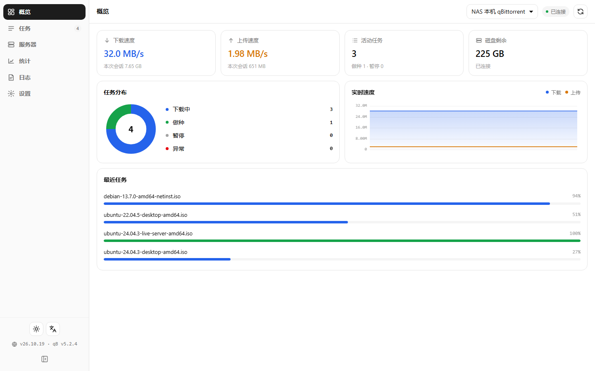 | 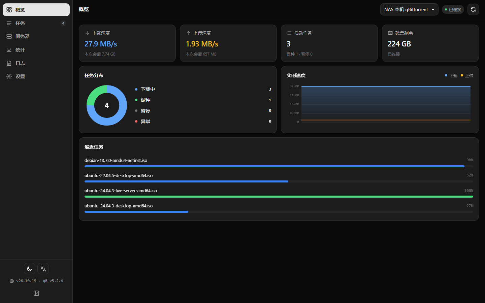 |

| 任务列表 | 任务详情（常规） |
|---|---|
| 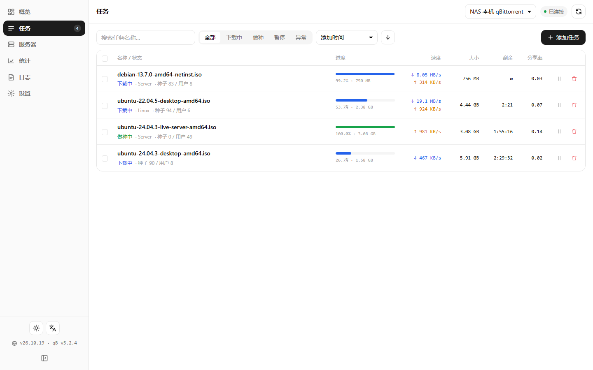 | 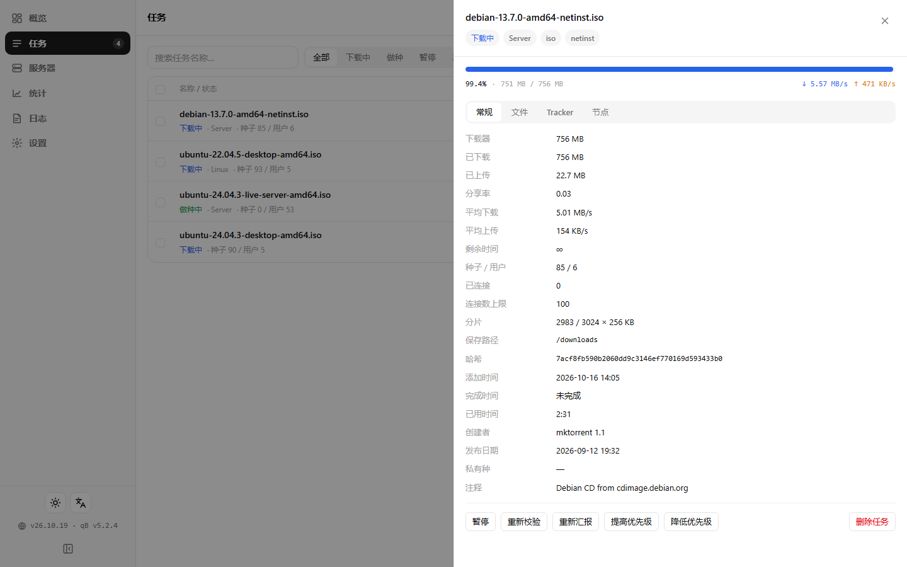 |

| 服务器 | 统计 |
|---|---|
| 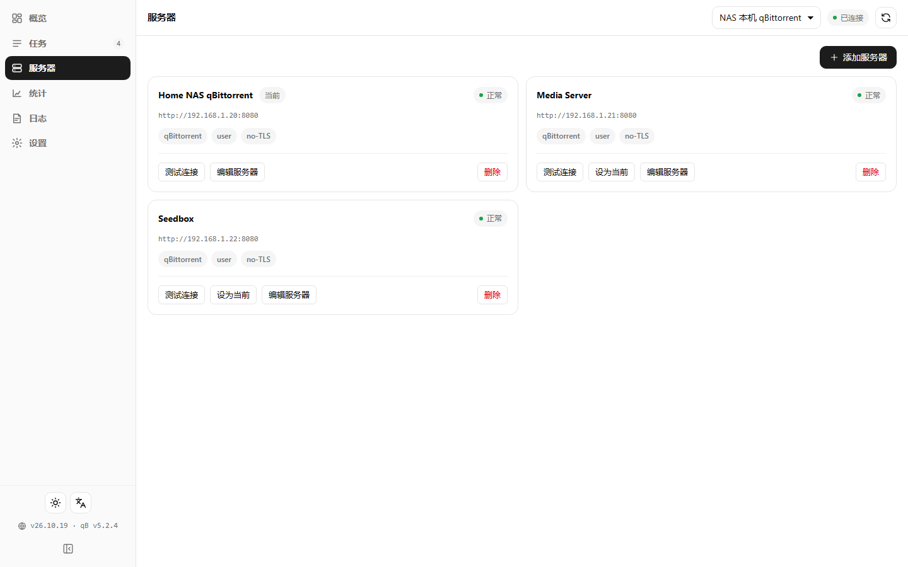 | 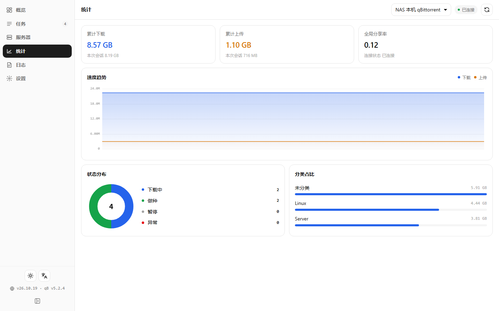 |

| 日志 | 设置 |
|---|---|
| 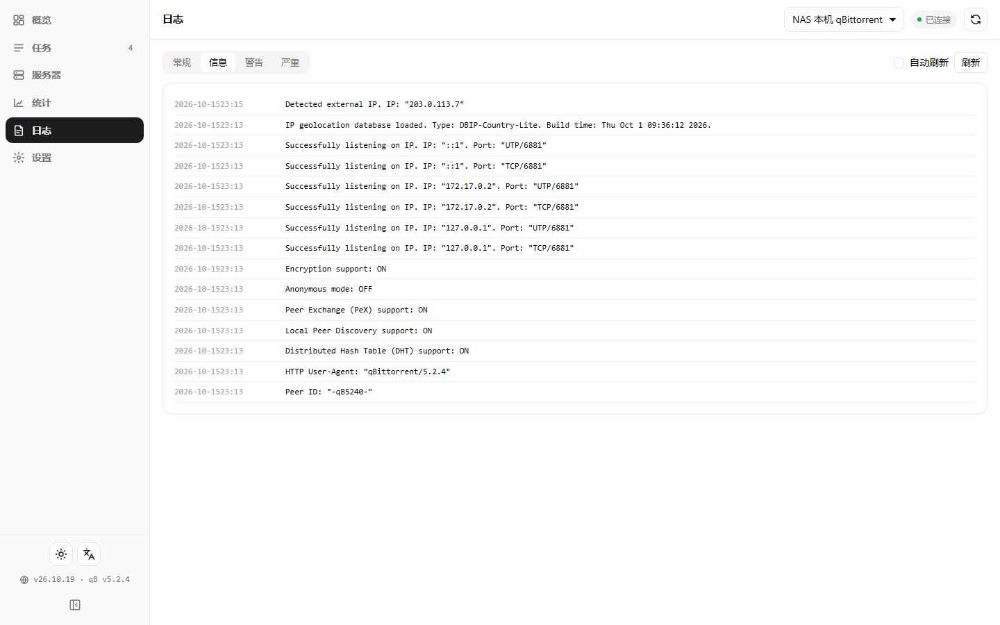 | 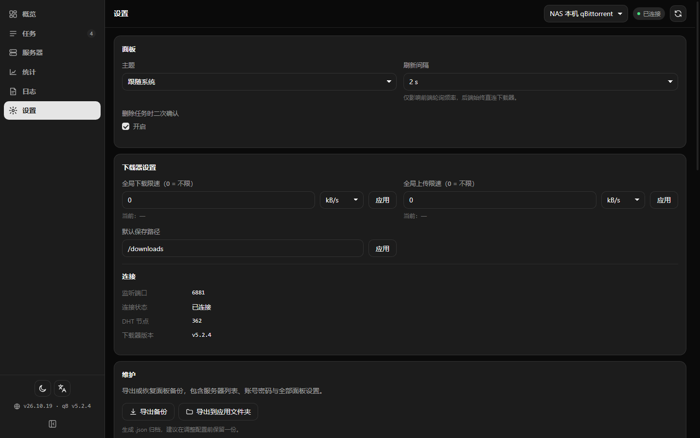 |

手机端（390px）：

| 概览 | 侧栏 | 任务 | 设置 |
|---|---|---|---|
| 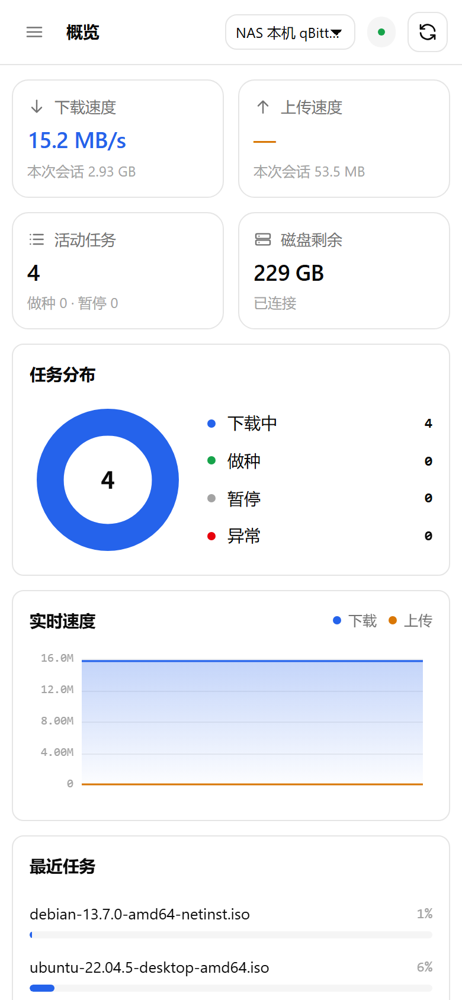 | 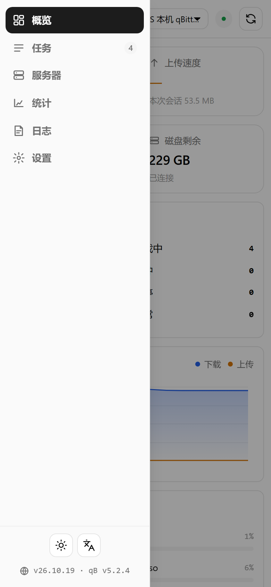 | 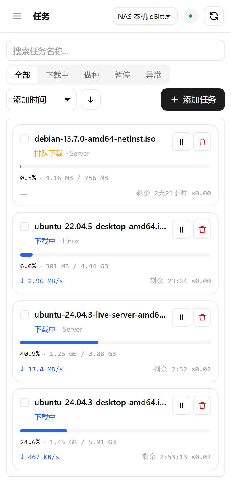 | 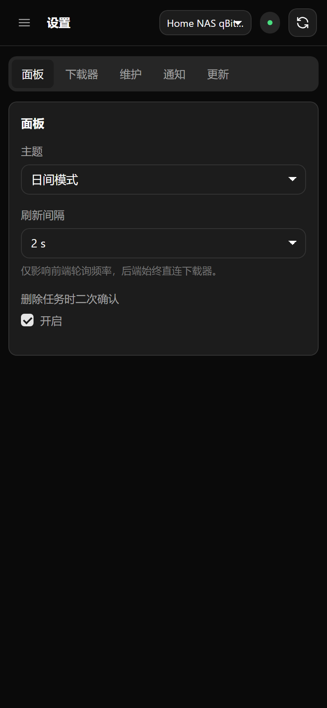 |

---

## 安装

### 前置条件

- 一台飞牛 fnOS 设备（x86 或 ARM 均可），系统已内置 Python 3；
- 已有一个可访问的 qBittorrent 或 Transmission 实例（可以和 fnOS 装在同一台机器上，也可以是局域网里另一台机器）。

### 方式一：应用中心手动安装（推荐）

1. 到本仓库的 [Releases](../../releases) 页面下载最新的 `fn-qbpanel-<版本>-fnos-all.fpk`；
2. 打开飞牛 fnOS → **应用中心** → **手动安装**，选择刚下载的 fpk；
3. 安装向导会让你填面板端口（默认 **8898**，被占用时换一个即可）；
4. 装好后飞牛桌面会出现 **qBpanel** 图标，点开即用；也可以直接用 `http://设备IP:8898` 访问。

### 方式二：命令行安装

```bash
# 把 fpk 传到设备上后执行（需要 sudo）
printf 'wizard_backend_port=8898\n' > /tmp/qbpanel.env
appcenter-cli install-fpk -e /tmp/qbpanel.env /path/to/fn-qbpanel-26.10.23-fnos-all.fpk
```

> 提示：`appcenter-cli` 安装时必须提供环境变量文件（`-e`），否则会报 `Something wrong with environment variables`；另外它**不会覆盖已安装的同名应用**，升级前需要先 `appcenter-cli uninstall fn-qbpanel`。

### 安装位置

| 内容 | 路径 |
|---|---|
| 程序 | `/usr/local/apps/@appcenter/fn-qbpanel` |
| 配置与日志 | `/usr/local/apps/@appdata/fn-qbpanel`（`config.json` 存服务器与设置） |
| 应用文件夹 | `/vol1/@appshare/fn-qbpanel/`（备份文件默认落在这里的 `backups/`） |

---

## 使用手册

### 1. 添加你的下载器

首次打开面板会看到「还没有配置下载器」。点 **添加服务器**：

| 字段 | 说明 |
|---|---|
| 名称 | 随便起，会显示在顶栏的切换下拉里 |
| 类型 | `qBittorrent` 或 `Transmission` |
| 地址 | **写在设备上能访问到的地址**。同一个容器/宿主机上可以填 `http://127.0.0.1:8080`；另一台机器就填 `http://192.168.x.x:8080` |
| 用户名 / 密码 | 下载器 WebUI 的登录凭据（Transmission 通常留空或用 RPC 账号） |
| 校验 HTTPS 证书 | 地址是自签名 HTTPS 时按需关闭 |

点 **测试连接** 会立刻验证地址与账号，成功会显示下载器版本；**保存后仍会自动测试一次**，状态芯片会直接显示「正常 / 失败」。填错了也没关系，密码留空表示不修改。

> 地址填写小技巧：先确定面板进程和下载器谁在哪台机器上。面板是装在 fnOS 本机的，所以「从 fnOS 这台设备能不能访问到该端口」才是判断标准，而不是你自己的电脑能不能访问。

### 2. 概览页

顶部四个数字卡：下载速度、上传速度、活动任务数、磁盘剩余。中间左侧是任务分布环形图（下载中 / 做种 / 暂停 / 异常），右侧是实时速度曲线，两条线分别是下载与上传，鼠标悬停可看具体数值。下方「最近任务」列出最近的活动任务及进度。

右上角的圆点是连接状态，旁边的刷新按钮可以立即拉取一次数据；刷新间隔在「设置」里调整（默认 2 秒，仅影响前端轮询频率）。

### 3. 任务页

- **搜索**：左上角输入框按名称过滤；
- **筛选**：全部 / 下载中 / 做种 / 暂停 / 异常；
- **排序**：名称、大小、进度、下载速度、上传速度、分享率、剩余时间、添加时间，可切换升降序；
- **批量操作**：勾选任务后，顶部工具条出现暂停、恢复、重新校验、限速、删除；「删除」会二次确认，并可选择「同时删除已下载的数据文件」（可在设置里关掉二次确认）；
- **限速**：对选中任务单独设置下载 / 上传上限，单位为 kB/s 或 MB/s，填 0 表示不限；
- **添加任务**：右上角「添加任务」，可粘贴磁力链接 / HTTP 链接（一行一个），或选择本地 `.torrent` 文件上传；可指定保存路径、分类、标签，也可以「添加到队列后暂停」。

点任意一行任务名会从右侧滑出**详情抽屉**：

- **常规**：下载器总大小、已下载 / 已上传、分享率、平均速度、剩余时间、种子 / 用户、连接数、分片、保存路径、哈希、添加 / 完成时间、创建者、发布日期、是否私有种、注释；
- **文件**：文件列表与大小，逐个设置优先级（跳过 / 普通 / 高 / 最高）；
- **Tracker**：站点地址、状态与消息，支持「重新汇报」；
- **节点**：对端 IP、端口、客户端、来源、上下行速度。

抽屉底部还有暂停、重新校验、重新汇报、提高 / 降低优先级、删除任务。

### 4. 服务器页

管理所有下载器实例：卡片式列表，每张卡显示名称、类型、地址、当前状态与下载器版本。可以**设为当前**（面板所有页面都作用于「当前服务器」），也可以在顶栏下拉里快速切换。相同地址的实例会被拒绝添加，避免出现一堆重复项。

### 5. 统计页

累计下载 / 上传、全局分享率、本次会话流量；速度趋势图；任务状态分布；分类占比（按下载器里的分类归集）；连接信息（监听端口、连接状态、DHT 节点、下载器版本）。

### 6. 日志页

直接读取下载器的日志，按级别着色显示，可开启自动刷新。顶栏切到另一台下载器后，日志会立刻清空并按新服务器重新读取——不会再把上一台服务器的日志留在屏幕上，切换途中返回的旧数据也会被丢弃。

### 7. 设置页

设置页顶部是一条分区工作条，点一下切换一组配置，不再需要一屏滚到底：

- **面板**：主题（夜间 / 日间 / 跟随系统，侧栏底部按钮也能快速切换）、刷新间隔、删除任务时二次确认；
- **下载器**：全局下载 / 上传限速（0 = 不限，单位可切 kB/s 与 MB/s，点「应用」写入下载器）、默认保存路径，以及只读的连接信息（监听端口、连接状态、DHT 节点、下载器版本）；
- **维护**：备份与恢复、自动备份、历史备份列表（见下一节）；
- **通知**：通知总开关、两类事件与通知渠道（见下）；
- **更新**：版本对比、更新说明与一键更新（见下）。

### 8. 通知

「设置 → 通知」里配置，支持五种渠道：

| 渠道 | 需要填写 |
|---|---|
| **Bark** | 服务器地址（如 `https://api.day.app`）+ 设备 Key |
| **Server 酱** | 以 `SCT` 开头的 SendKey |
| **PushPlus** | token |
| **WxPusher** | appToken，可选 UID / 主题 ID |
| **自定义 Webhook** | POST 地址，可选自定义请求头（每行 `Key: Value`） |

两类事件分别开关：**任务下载完成**（进度到 100% 时推送一次，同一条任务只发一次）、**版本更新**（发现新版本推一次，同一版本不重复）。添加渠道后可用「测试」立即验证，密钥只保存在设备本地且不会回显。

#### 投递记录

渠道卡片下面是**投递记录**，每次推送都会留一条：任务下载完成、发现新版本、手动点「测试」都算。每条写明：

- **成功 / 失败**，失败直接给出原因（HTTP 状态码、超时、目标拒绝连接等）；
- 推送的**标题与正文**（正文最多保留 600 字），方便确认到底发出去了什么；
- **渠道名**、事件类型（下载完成 / 版本更新 / 测试）与时间。

列表可按「全部 / 成功 / 失败」筛选，也可手动刷新或一键清空。记录存在 `/usr/local/apps/@appdata/fn-qbpanel/notify-log.json`，最多保留最近 200 条；记录只包含推送内容，不含任何渠道密钥。

### 9. 版本更新

打开面板后会自动向项目发布页查询一次最新版本（之后按需手动刷新）：

- 有新版本时，左下角侧栏的「设置」会打一个小红点，**每个页面顶部也会出现提示条**（本次可关闭），点「一键更新」直接升级；
- 「更新」分区用「当前版本 → 最新版本」对比展示，下面是状态条、版本更新说明与发布时间；
- **一键更新**：面板下载对应的 `.fpk` 并调用系统安装器完成升级，升级过程中页面会自动等待新版本上线并刷新；若新版本启动失败，会自动回滚到上一版本再启动；
- 检查更新走 GitHub 发布页：接口被限流（403）时自动改用发布订阅源与资源列表，仍能拿到版本号、更新说明与安装包。

> 设备无法访问 GitHub 时，这一项会显示失败原因，其余功能不受影响。

---

## 备份与恢复

面板配置（服务器列表、账号密码、所有设置）可以整体备份：

| 操作 | 说明 |
|---|---|
| **导出备份** | 生成 `.json` 归档下载到本机。桌面端走浏览器下载；手机端（飞牛 App）会交给系统下载器，完成后到通知栏查看 |
| **导出到应用文件夹** | 直接写入 NAS 的 `/vol1/@appshare/fn-qbpanel/backups/`，无需下载，从文件管理器即可拿到 |
| **导入备份** | 选择备份文件，覆盖当前配置（导入后会刷新页面） |
| **自动备份** | 开启后可设置间隔（1–8760 小时）与保留时间（1–3650 天），到点自动写入应用文件夹；开启瞬间会先生成第一份 |
| **历史备份** | 列表最多展示五行，更多时在卡片内上下滚动（表头固定）；每行可一键**恢复**或**删除**。手机端会把共用的文件名前缀省掉，直接显示时间戳 |

> 忘了面板密码不用慌：备份文件里就有明文凭据，从应用文件夹拷出来打开即可。

---

## 手机端

在飞牛 App 里打开 qBpanel 会自动切换为移动布局：侧栏收进左上角菜单、下拉框变成底部选择器、任务以卡片呈现、详情抽屉与弹窗适配小屏。整页禁用了长按选择与点击蓝色高亮，滑动手感更接近原生。

浏览器直接访问时，屏幕宽度小于 640px 也会进入同一套移动布局。

---

## 深链参数

| 参数 | 取值 | 作用 |
|---|---|---|
| `view` | `dash` / `torrents` / `servers` / `stats` / `logs` / `settings` | 直接打开指定页面 |
| `theme` | `dark` / `light` / `system` | 强制主题（不写入设置） |
| `lang` | `zh` / `en` | 强制界面语言 |
| `hash` | 任务哈希 | 打开任务页并展开该任务详情 |

示例：`http://设备IP:8898/?view=torrents&theme=dark&lang=en`

---

## 从源码构建 fpk

源码结构：

```
qbpanel/
├── manifest                 # 应用元信息：包名、版本、端口、平台
├── ICON.PNG / ICON_256.PNG  # 应用图标（64 / 256）
├── config/
│   ├── privilege            # 运行身份（root）
│   └── resource             # 应用文件夹声明
├── wizard/
│   ├── install              # 安装向导（面板端口）
│   └── config               # 应用设置向导
├── cmd/main                 # 生命周期脚本：start / stop / status
└── app/
    ├── server/              # qbpanel.py（HTTP 服务与路由）、backends.py（下载器适配）
    ├── web/                 # index.html + style.css + js/ + lib/vue.global.prod.js
    └── ui/                  # 桌面入口（index.cgi 反向代理到本地端口）与图标
```

### 用 GitHub Actions 构建（推荐）

仓库自带 `.github/workflows/build-fpk.yml`，不需要本地环境：

- **推 `v*` 标签** → 自动构建 → 校验包结构 → 上传 workflow artifact，并把 `.fpk` 附到该标签的 Release（发布说明自动取出 `CHANGELOG.md` 里对应版本那一节）
- **Actions 页面手动 Run workflow** → 只构建并上传 artifact，不动 Release

所以发版就是三步：改 `qbpanel/manifest` 的 `version`（顺带 `index.html` 的 `?v=` 与 `CHANGELOG.md`）→ commit → `git tag v<版本> && git push --tags`。

CI 用官方 `fnpack-1.2.3-linux-amd64`（<https://static2.fnnas.com/fnpack/>），构建前统一修正权限：目录 755、文件 644、`cmd/*` 与 `app/ui/index.cgi` 755。

### 本地打包（备用）

```bash
python tools/build_fpk.py           # 走 remote.py 把源码同步到飞牛设备用 fnpack 打包
python tools/verify_fpk.py *.fpk    # 自检：版本号、可执行位、关键文件
```

> ⚠️ **不要在 Windows 上手工重新打 tar 包**：会破坏归档格式，安装时报 `code 10111`。正确做法是让官方 `fnpack build` 在 Linux 侧打包，CI 或 `tools/build_fpk.py` 都是这条流程。

本地跑起来看效果（不需要打包）：

```bash
cd qbpanel/app/server
TRIM_PKGVAR=../../_local/var \
QBPANEL_SHARE_DIR=../../_local/share \
QBPANEL_PORT=8898 python3 qbpanel.py
```

然后浏览 `http://127.0.0.1:8898`。

---

## 常见问题

**面板打不开 / 端口被占用**
换一个端口：应用设置里改端口后会重启服务；也可以在安装时指定。

**提示连接失败，但我在电脑上能打开 qBittorrent**
地址要以**面板所在设备**的视角来填。如果下载器跑在同一台 fnOS 上，用 `http://127.0.0.1:8080`；如果跑在另一台机器，用局域网 IP。

**qBittorrent 5.x 能用吗**
可以。5.x 的登录返回码、会话 cookie 名、`stop/start` 端点与状态名变化都已在后端兼容。

**Transmission 的分类和优先级为什么不一样**
Transmission 没有分类字段，面板取第一个标签作为分类；优先级取队列位置。这是协议本身的差异。

**怎么修改面板端口？**
在应用设置（`cmd/config` 向导）里改，保存后服务会重启并应用新端口。

**数据存在哪？备份在哪？**
配置在 `/usr/local/apps/@appdata/fn-qbpanel/config.json`；备份默认在 `/vol1/@appshare/fn-qbpanel/backups/`。

---

## 安全说明

- 下载器的账号密码只保存在设备本地配置文件里，不会写入网页、不上传任何外部服务；
- **面板本身没有登录验证**，设计上只用于局域网。请不要把 8898 端口直接映射到公网；确有远程需求时，请自行套一层反向代理并加上认证（或走 VPN / 飞牛的远程访问）；
- 导出的备份文件包含明文凭据，请妥善保管。

---

## 已知限制

- 单个下载器实例同一时刻只有一份登录会话，面板与网页版 WebUI 同时使用没有冲突，但下载器侧改密码后需要在面板里同步更新；
- Transmission 的分类 / 标签 / 优先级只能近似映射（见上）；
- 面板不代理下载流量，仅转发控制指令。

---

## 许可

[MIT](LICENSE) © 2026 Smi13zZ

本项目与 qBittorrent、Transmission、飞牛 fnOS 官方均无隶属关系。
