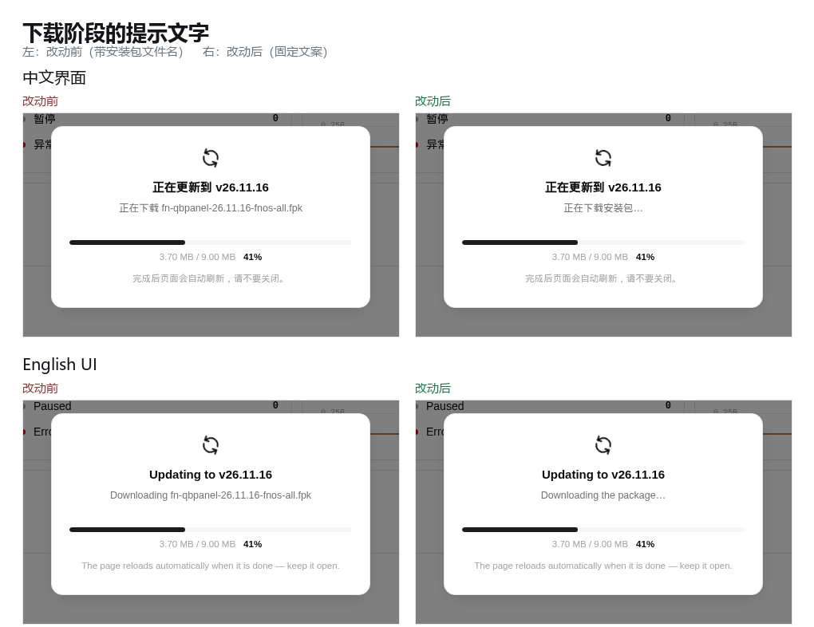

# qBpanel 26.11.16 下载阶段文案

## 改了什么

一键更新的进度区在下载阶段固定显示「正在下载安装包…」，英文界面显示
`Downloading the package…`。不再拼接安装包文件名。

## 为什么

26.11.15 为了让英文界面不冒出中文句子，把这一段的文案改成「服务端下发语言中立的文件名、
前端按语言拼句子」。结果是句子随每次发版的包名变化，用户看到的提示不稳定，
而包名本身对使用毫无帮助——下载完就进入安装重启，用户不需要核对包名。

现在中英各只有一条固定文案，服务端不再传文件名，前端也不再按名字拼句子。

## 代码改动

| 位置 | 改动 |
|---|---|
| `qbpanel/app/server/qbpanel.py` | `UPDATE_STATE` 去掉 `file` 键；`_set_update()` 去掉 `file` 参数与写入；三处调用不再传包名；`start_update()` 的返回值去掉 `file` |
| `qbpanel/app/web/js/app.js` | `applyUpdateState()` 的 downloading 分支直接取 `update.downloading` 文案 |
| `qbpanel/app/web/js/i18n.js` | 删掉 `update.downloadingFile`（中英各一条），该键已无引用 |

## 验证

后端（设备上把网络与安装脚本打桩后真跑 `start_update()`）：

- `/api/update/install` 返回 `{"ok": true, "version": "26.99.1"}`，没有 `file` 字段
- `/api/update/status` 的字段为 `phase/version/detail/done/total/current/log`，没有 `file`
- 下载阶段的 detail 为空串，字节计数 `done=1234 total=5678` 完整保留

前端（真机无头浏览器，四个场景 + 两个对照场景）：

| 场景 | 阶段文案 | 页面是否出现 `.fpk` |
|---|---|---|
| 中文 · 下载 | 正在下载安装包… | 否 |
| 英文 · 下载 | Downloading the package… | 否 |
| 中文 · 安装重启 | 安装包已就绪，正在重启服务… | 否 |
| 英文 · 安装重启 | Package ready, restarting the service… | 否 |

对照：把文案改回 26.11.15 的写法（`正在下载 fn-qbpanel-26.11.16-fnos-all.fpk`）
在同一张卡片上渲染，作为「改动前」一栏。

上传给前端的状态里刻意保留了旧的 `file` 字段，界面照旧不显示包名——证明该字段确实无人读取。

## 其他

`backends.py` 的版本兜底值同步到 `26.11.16`。质量闸门全部通过：`py_compile`、
`node --check` ×5、`check_icon_case.py`、`verify_fpk.py`。
