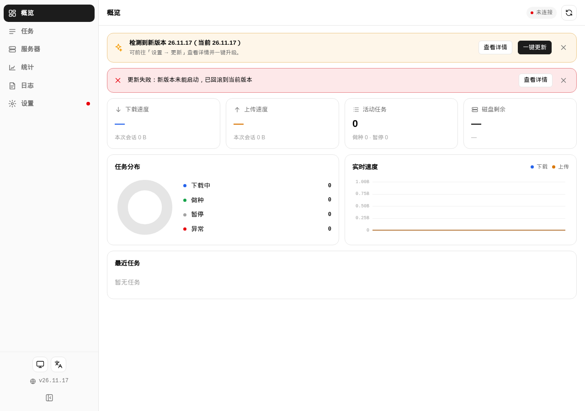
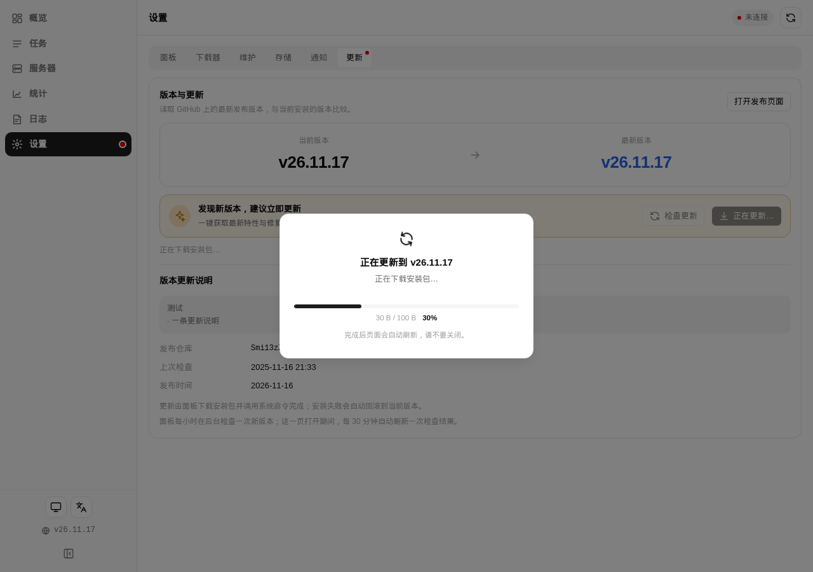
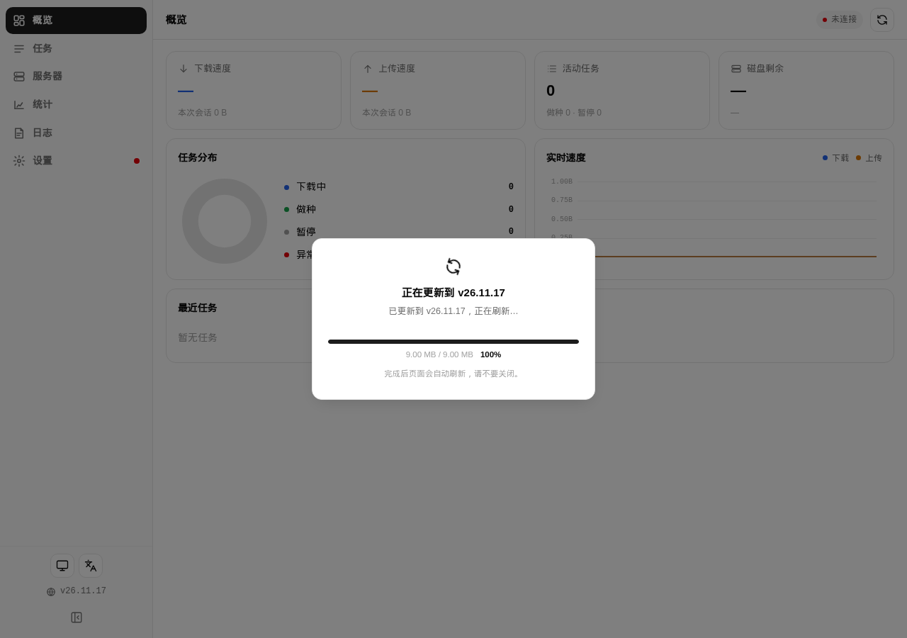
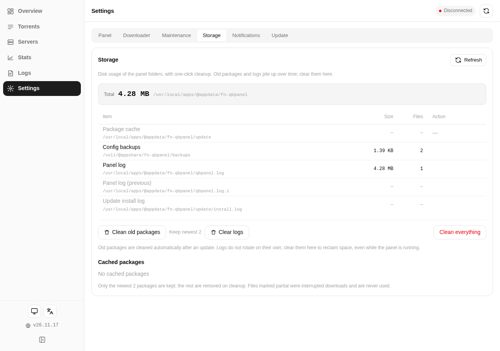

# qBpanel 26.11.17 一键更新全链路修复

审计发现的 8 个问题一次修完，另加一轮死代码清理。

## 1 · 失败提示在任何页面都能看到

从概览页顶部横幅点「一键更新」，失败后原先**界面上一个字都没有** —— 失败提示只
渲染在设置-更新的卡片里。现在内容区多一条独立提示，带「查看详情」直接跳过去。



## 2 · 重试不再被上一次的失败打断

服务端的失败状态不会自己回到 idle，而新一轮安装请求要先把版本检查跑完才改阶段。
重试后第一个轮询（400ms 后）读到的是上一轮的死信：弹窗当场关闭、报的还是上次的原因，
下载却在后台继续跑。

现在每次尝试带一个递增的 `attempt`，界面只认属于本轮编号的失败：

```
before: phase=failed attempt=0
after : phase=installing attempt=1     ← 新一轮立刻接管
```



同时把「检查中」也纳入进行中判定，连点两次不会起两个下载。

## 3 · 成功那一帧不再假报「100 B / 100 B」

`finishUpdate()` 把字节计数器当成百分比写成 100/100。现在保持下载结束时的真实总量：

| 场景 | 修复前 | 修复后 |
|---|---|---|
| 下载有总量 | `100 B / 100 B` `100%` | `9.00 MB / 9.00 MB` `100%` |
| 下载无总量 | `100 B / 100 B` `100%` | 退回「准备中…」，不编数 |



## 4 · 回滚真正可用

`find_previous_fpk()` 只在两个固定共享目录里找，而一键更新把每个包都下载到面板自己
的 `update/` 目录 —— 升级过一次之后，「当前运行版本」的包明明就在那儿却永远找不到，
安装脚本的回滚分支从来没执行过。

现在优先在 `update/` 里找（取最新的一份），实机验证：

```
update/ 放 fn-qbpanel-26.11.17-fnos-all.fpk
  → find_previous_fpk() 返回它
  → /api/update/status 的 rollback = true
```

找不到时界面改说「当前版本没有可用的安装包副本，安装失败时无法自动回滚」，不再承诺做不到的事。

## 5 · 下载中断不再留下半截安装包

原先直接写最终文件名，断流留下的残缺 ` .fpk ` 会被当成完整包：清理删不掉，还占掉
「保留 2 个」的名额。现在先写 ` .part `，全部收齐才 `os.replace()` 改名。

实测：截断的包不再出现在缓存清单里，`partial` 标记正确。

## 6 · 存储页合计不再重复计算

`install.log` 在 `update/` 里，既是目录的一部分又单列一行：

```
修复前 total 110614  vs  磁盘实际 60614   ← 正好把 50000 的日志算了两次
修复后 total  60614  vs  磁盘实际 60614   ✅
```

嵌套行加 `nested: true`，照常显示但不计入合计。

## 7 · 英文界面不再出现中文

服务端原先只把网络异常翻译成中文，其余（校验失败、各种拒绝）是硬编码中文，`str(exc)`
直接透出，英文界面就成了：

```
Update failed: 域名解析失败，请检查设备的网络与 DNS 设置
Update failed: 更新已在进行中
```

现在服务端同时下发语言中立的 `code`，界面按当前语言翻译，共 18 个错误码覆盖下载、
校验、检查与全部拒绝原因：

```
Update failed: DNS lookup failed — check the device's network and DNS settings.
Update failed: An update is already running.
Check failed: GitHub rate limit reached. Try again later.
```

存储页的五行标签也从服务端硬编码中文改成界面自取，英文界面实测零中文：



## 8 · 死代码清理

全部经全仓检索确认零引用：

| 位置 | 内容 |
|---|---|
| `backends.py` | `cookie_value()` 12 行（注释写「向后兼容」，实际无调用方） |
| `notify.py` | `type_list()` 10 行（已被 `type_meta()` 取代） |
| `app.js` | 图标 `send`、`pencil` |
| `style.css` | `--hover`（两套主题都声明，0 处引用） |
| `i18n.js` | `side.theme`（裸键，实际走前缀拼接） |
| 接口 | `check.current` / `check.name` / `check.cached` / `check.source` |
| 接口 | `status.version` / `status.at`（连带 `_set_update(version=)` 死参） |
| 接口 | `install.version`、`storage.items[].kind` |

清理后审计：i18n 中英各 475 键完全对齐、无重复；未引用键 0、未渲染图标 0、
未使用 CSS 变量 0、未使用 CSS 类 0、未引用后端函数 0、未使用 import 0。

## 验证

打包前闸门：`py_compile` ×3、`node --check` ×5、`check_icon_case`，全部通过。

后端单元测试（真机、打桩网络与安装器）：

| 项 | 结果 |
|---|---|
| 中断下载不留假包 | `no_fake_pkg: true` |
| 正常下载走 `.part` → rename | `partial_left_behind: false` |
| 回滚包能在 update/ 找到 | `find_previous: fn-qbpanel-26.11.16-fnos-all.fpk` |
| 存储合计 = 非嵌套行之和 | `MATCH: true` |
| 重试编号递增 | `attempts: 1 → 2` |
| 检查中也算进行中 | `busy_when_checking: busy` |
| 错误码映射 | gaierror→netDns、HTTP403→gh403、超时→netTimeout、SSL→netTls |

界面实测（真机无头浏览器 + DOM 探针）：

| 场景 | 结果 |
|---|---|
| 概览页失败提示 | 出现，文案与「查看详情」正常 |
| 重试 | 3 次轮询后进入 downloading，遮罩保持，未报旧错误 |
| 成功帧 | `9.00 MB / 9.00 MB` `100%` |
| 无总量成功帧 | 显示「准备中…」 |
| 英文错误 | 7 个错误码全英文，无中文 |
| 英文存储页 | 5 行标签全英文，整页零中文 |
| 无回滚包时的提示 | 切到「无法自动回滚」文案 |
